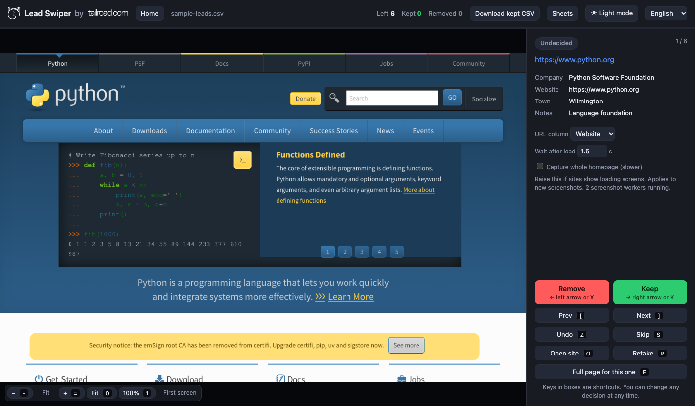

# Lead Swiper

Review a CSV of scraped leads at speed. Drop the file in, flick through a screenshot of each website, and keep or remove each one with the arrow keys. The kept rows are written back out as a CSV with all the original columns intact.

Built for the "I scraped 500 businesses, which ones are actually worth contacting?" problem. Each site takes about two seconds to judge, so the tool is designed around never making you wait: it screenshots sites ahead of you in the background.

Runs entirely on your machine. No accounts, no API keys, nothing leaves your computer.



## Requirements

- Python 3.9 or newer
- About 150 MB of disk space for the bundled headless Chromium

Works on macOS, Linux and Windows.

## Install

```
git clone https://github.com/YOUR_USERNAME/leadSwiper.git
cd leadSwiper
pip3 install -r requirements.txt
python3 -m playwright install chromium
```

The last command downloads a copy of Chromium that Playwright uses for screenshots. It only needs running once.

## Run

```
python3 app.py
```

Then open http://localhost:8765 in your browser and drop your CSV onto the page. There's a small one to try in `examples/sample-leads.csv`.

## Options

Everything can be tuned from the command line. Run `python3 app.py --help` to see the full list.

| Flag | Default | What it does |
|---|---|---|
| `--workers N` | 3 | How many browser tabs take screenshots in parallel. Raise it on a fast machine with a long list; lower it if your laptop fans spin up. |
| `--wait SECONDS` | 1.5 | How long to wait after a page loads before taking the screenshot. Raise it if lots of your sites have loading screens or fade-in animations. |
| `--timeout SECONDS` | 12 | How long to give a slow site before screenshotting whatever has rendered so far. |
| `--prefetch N` | 8 | How many sites ahead of you to screenshot in the background. |
| `--full` | off | Capture whole homepages instead of just the first screen. Can also be toggled in the sidebar. |
| `--port N` | 8765 | Port to serve on. |
| `--width`, `--height` | 1280 x 800 | Browser viewport size for the screenshots. |

For example, for a long list on a fast machine where many sites have splash screens:

```
python3 app.py --workers 6 --wait 3
```

The wait time can also be changed while you're reviewing, from the box in the sidebar. It applies to all screenshots taken from then on and is remembered between runs. A `--wait` flag on the command line overrides the remembered value.

## Using it

| Key | Action |
|---|---|
| → or K | Keep this lead |
| ← or X | Remove this lead |
| Z | Undo the last decision, restoring what the lead was before |
| S | Skip for now (it comes back at the end) |
| O | Open the site in your normal browser |
| R | Retake the screenshot using the current wait setting |
| [ or P | Go to the previous lead |
| ] or N | Go to the next lead |
| F | Capture the whole homepage for this lead only |
| + and - | Zoom the screenshot in and out |
| 0 | Fit the screenshot to the panel |
| 1 | Show the screenshot at actual size |
| H | Home: close the sheet and show the list of sheets and the drop zone |
| Esc | Back to the summary screen (once every lead is decided) |
| Enter | Start reviewing decisions from the summary screen |

There are also buttons for each of these in the sidebar.

**Seeing more of the page.** By default each screenshot is the first screen of the site, which is usually enough to judge it. Press F to capture the whole homepage for the lead you're looking at, or tick "Capture whole homepage" in the sidebar to do it for every site (slower, and the images are bigger). Full-page shots open fitted to the panel width and scroll like the real page. Zoom with + and -, or use the buttons in the top-left of the screenshot. Both kinds of screenshot are cached separately, so switching modes doesn't throw away what's already been captured.

**Changing your mind.** Every card shows a pill with its current status: Kept, Removed or Undecided. Use [ and ] to step through any lead, decided or not, and press keep or remove to change it. When you've been through the whole list, the summary screen has a "Review decisions" button that walks you through all of them from the start.

**Loading screens.** If a screenshot catches a site mid-load, raise "Wait after load" in the sidebar and press R. Only that site is re-screenshotted, so you can drop the wait back down afterwards rather than slowing every other site. If most of your sites need it, just leave the higher value in place.

The sidebar shows every column from the CSV row, so you can see the business name, location or anything else you scraped alongside the screenshot.

## CSV format

Any CSV with a header row and a column of website addresses. Bare domains like `example.com` are fine, as are full URLs.

The website column is detected automatically. A header called `website`, `url`, `domain` or `homepage` wins outright; otherwise a header containing one of those words is used, skipping social-profile columns like LinkedIn or Instagram; failing that, the column whose values look most like domains. If it guesses wrong, there's a dropdown in the sidebar to pick the right one.

UTF-8 files are read as they are. Files saved by Excel in a legacy encoding (Shift_JIS, GBK, Big5, Windows-1252) are detected, with the app's current language used as a hint about which to try first. The server prints which encoding it used when a file is loaded. Output files are written as UTF-8 with a byte-order mark so Excel opens them correctly on any platform.

Example:

```
Practice Name,Website,Phone,Town
Smith Architects,smitharchitects.co.uk,01234 567890,Bristol
Jones Design,https://www.jonesdesign.com,01234 567891,Bath
```

## Output

Every decision is saved immediately. Two files are kept up to date in the `output/` folder:

- `output/<your file>_kept.csv`
- `output/<your file>_removed.csv`

Both contain the full original rows. The "Download kept CSV" button in the header downloads the kept file at any point, and you don't have to finish the whole list first.

If you drop in two sheets with the same file name, the second one's output files get a date suffix so they don't overwrite the first.

## Sheets and resuming

Every CSV you drop in becomes a sheet, saved as a plain JSON file in `sessions/`. The home screen (the "Home" button or H) lists all your sheets with their progress and takes a new CSV. "Sheets" in the header opens the same list as a dropdown for quick switching without leaving the current sheet. From either you can open an old sheet or delete one you're done with.

Stop the server whenever you like. Start it again later and it reopens the sheet you were on, at the first lead you haven't decided yet.

"New CSV" in the Sheets panel closes the current sheet and shows the drop zone. The sheet stays in the list, nothing is lost.

Screenshots are cached in `shots/` and shared across sheets, so a site you've seen in an earlier list appears instantly.

Deleting a sheet removes its progress file and its cached screenshots. A screenshot is kept if another sheet still lists the same site. The CSVs already written to `output/` are untouched.

## Project layout

```
app.py            server: CSV handling, screenshot workers, sheets, API
index.html        page markup
static/style.css  styles, including the light and dark palettes
static/app.js     front-end behaviour
static/i18n.js    UI translations
```

No build step. Edit a file, reload the page (or restart the server for app.py changes).

## How it works

A small Python server (standard library only, no framework) serves a single-page UI and runs a few headless Chromium tabs via Playwright. The tabs screenshot the sites ahead of your position so the next card is usually ready before you swipe.

Sites that are slow or broken are given a set time to load (12 seconds by default). After that, loading is stopped and a screenshot is taken of whatever rendered. Sites that fail entirely show an error card with an "Open in browser" button so you can still check them by hand.

## Appearance and language

The header has a light/dark toggle and a language menu. Both are remembered in your browser.

Languages: English, 日本語, 繁體中文 and 简体中文. The language is picked automatically from your browser on first visit. The CSV contents are always shown exactly as they are; only the app's own labels are translated.

To add a language, copy one of the blocks in `static/i18n.js`, translate the strings, and add an option to the language menu in `index.html`.

## Logo

The header shows a logo mark before the title and a wordmark after "by", both linking to the maker's site. They're served from `logoCat.svg` and `logo.svg` in the project folder; png, jpg and webp also work. The name "Tailroad Labs" and the link target are in `index.html` if you're forking this and want your own branding there. Either image can be left out: the mark simply disappears and the wordmark falls back to text. Use light-coloured artwork; the app darkens it automatically in light mode.

## Troubleshooting

**"Port 8765 is already in use"**
Another copy of the app is running. Close the other terminal, or start this one on a different port with `python3 app.py --port 8766`.

**"playwright not installed"**
Run the two install commands above. If you have several Python versions, make sure `pip3` and `python3` point to the same one.

**A site shows "Couldn't load this site" but works in my browser**
Some sites block headless browsers, or take longer than the load timeout. Press R to try again, or O to open it in your real browser and decide from there.

**Screenshots show a loading spinner or blank page**
The site has a loading screen that outlasts the default 1.5 second wait. Raise "Wait after load" in the sidebar and press R to retake that one.

**It's slow to get through the list**
Try more workers, e.g. `python3 app.py --workers 6`. Each worker is a browser tab, so memory use goes up with the count.

**Screenshots look wrong or stale**
Delete the `shots/` folder. It's only a cache and will be rebuilt.

## Privacy

The only network traffic is the headless browser visiting the sites in your CSV. Your CSV, screenshots and decisions stay on your machine. `shots/`, `output/`, `sessions/` and `state.json` are git-ignored so they can't be committed by accident.

## License

MIT. See [LICENSE](LICENSE).
